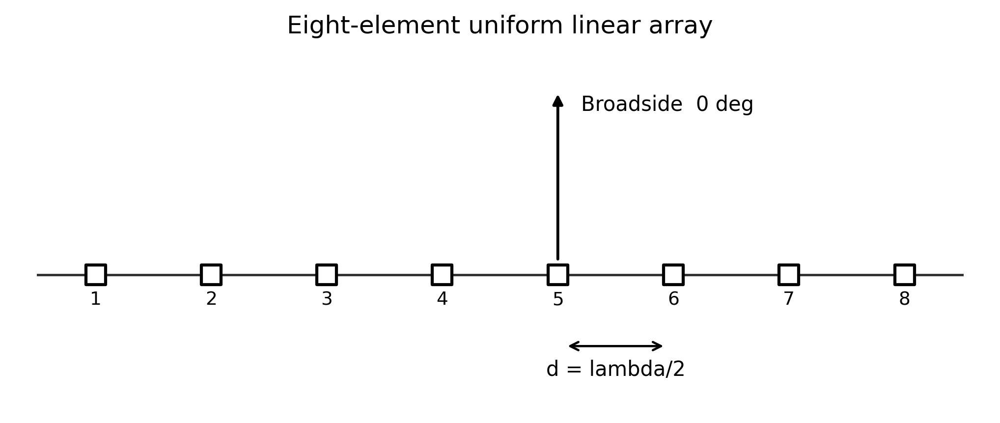
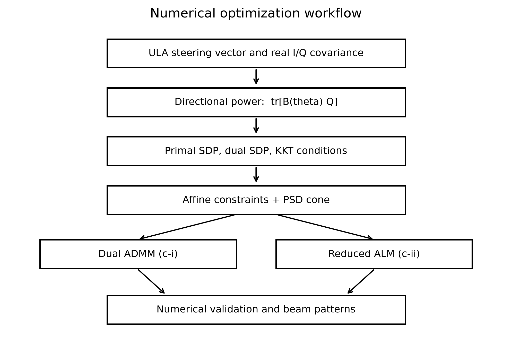
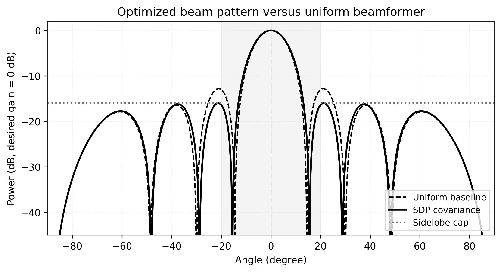
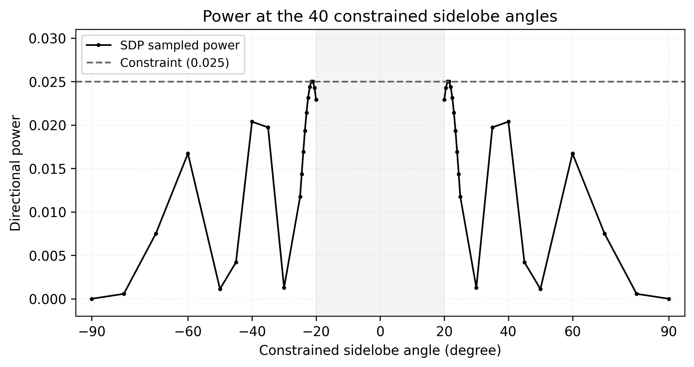
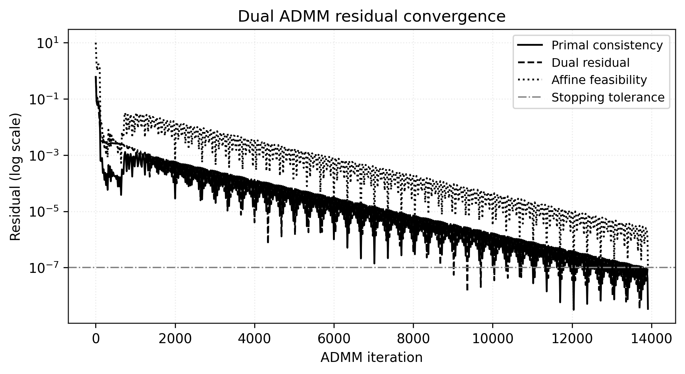
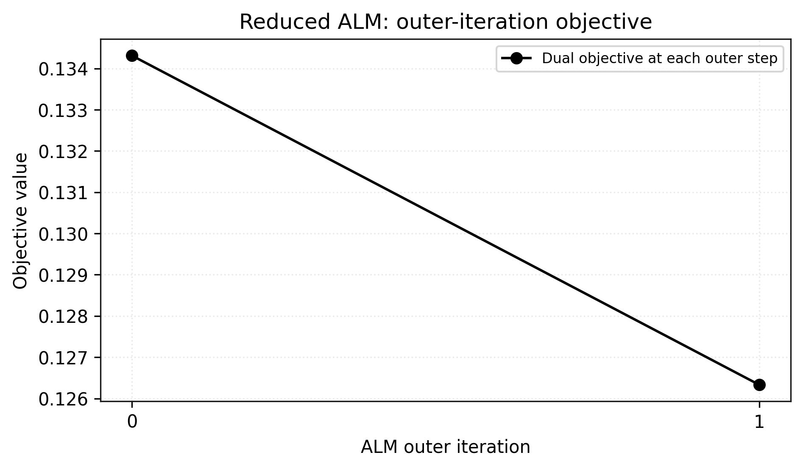
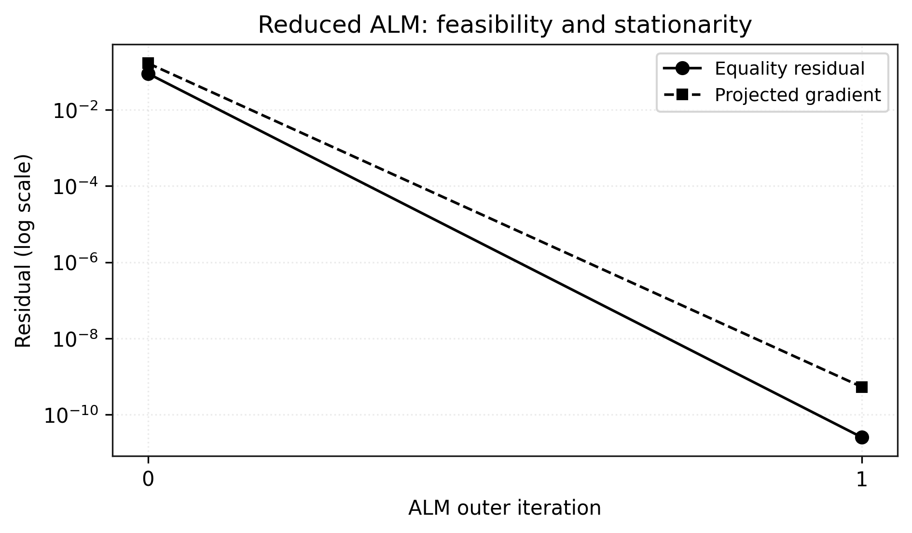
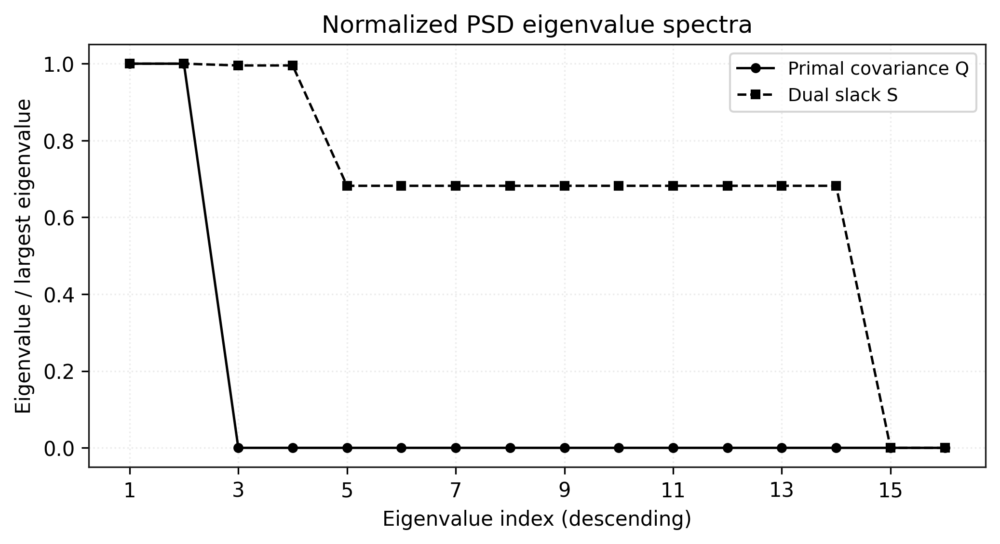
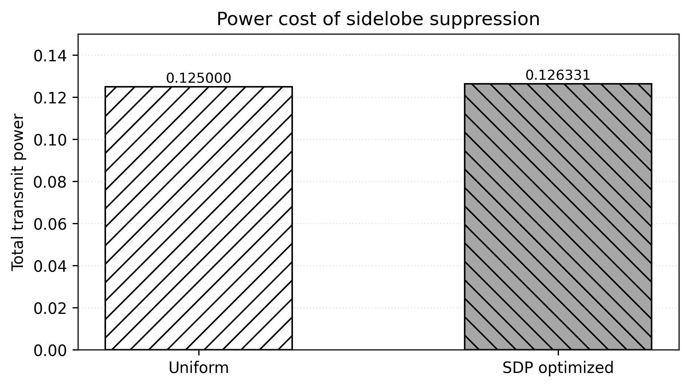

# Mathematical-model-Semidefinite-Programming
# Semidefinite Programming for mmWave Beamforming

**Reproducible optimization experiments with ADMM, an augmented Lagrangian method, and KKT verification**

This repository accompanies a mathematical modeling project on transmit beamforming for a millimeter-wave (mmWave) uniform linear array (ULA). It contains a self-contained Python implementation of the **primal and dual semidefinite programs (SDPs)**, two numerical optimization approaches, numerical optimality checks, and **nine figures generated directly from the experiment**.

The experiment uses an eight-element array at 28 GHz. A covariance-based SDP minimizes transmit power while maintaining a prescribed response in the desired direction and limiting radiation at 40 sampled sidelobe angles.

## Contents

- [Quick start](#quick-start)
- [Optimization model](#optimization-model)
- [Experimental configuration](#experimental-configuration)
- [Numerical results](#numerical-results)
- [Figures](#figures)
- [Code structure](#code-structure)
- [Reproducibility and validation](#reproducibility-and-validation)
- [References](#references)

## Quick start

**Requirements:** Python 3.10+ with NumPy, SciPy, and Matplotlib. No external dataset, network request, or proprietary solver is needed.

From the **repository root**:

```bash
python -m pip install -r requirements.txt
python -m unittest discover -s tests -v
python run_experiment.py
```

The main script recalculates the optimization results and writes:

- Nine monochrome, 300-DPI PNG figures to [`figures/`](figures/).
- Convergence histories and directional-power samples to [`results/`](results/).
- The primal covariance matrix and dual variables to `results/matrices.npz`.
- Numerical performance and KKT diagnostics to `results/metrics.json`.

On some systems, setting `OPENBLAS_NUM_THREADS=1` or `OMP_NUM_THREADS=1` can improve consistency of runtime. The dual ADMM run uses a strict tolerance and may take substantially longer than the unit tests.

## Optimization model

### Real-valued I/Q covariance formulation

Let $x\in\mathbb{C}^{N}$ denote the complex baseband transmit signal and let

$$
z=\begin{bmatrix}\operatorname{Re}(x)\\\operatorname{Im}(x)\end{bmatrix}\in\mathbb{R}^{2N},
\qquad
Q=\mathbb{E}[zz^{\mathsf T}]\succeq 0.
$$

For steering vector $a(\theta)$, define

$$
u(\theta)=\begin{bmatrix}\operatorname{Re}(a(\theta))\\\operatorname{Im}(a(\theta))\end{bmatrix},
\qquad
v(\theta)=\begin{bmatrix}-\operatorname{Im}(a(\theta))\\\operatorname{Re}(a(\theta))\end{bmatrix},
$$

$$
B(\theta)=u(\theta)u(\theta)^{\mathsf T}
           +v(\theta)v(\theta)^{\mathsf T}.
$$

Directional transmit power is linear in the covariance matrix:

$$
P(\theta)=\operatorname{tr}\bigl(B(\theta)Q\bigr),
\qquad
P_{\mathrm{tx}}=\operatorname{tr}(Q).
$$

### Primal SDP

With desired direction $\theta_0=0^\circ$, minimum desired response $G_0=1$, sidelobe sampling set $\Theta_s$, and sidelobe cap $\gamma=0.025$:

$$
\begin{aligned}
\underset{Q\succeq 0}{\operatorname{minimize}}\quad
   & \operatorname{tr}(Q)\\
\text{subject to}\quad
   & \operatorname{tr}\bigl(B(\theta_0)Q\bigr)\ge G_0,\\
   & \operatorname{tr}\bigl(B(\theta_k)Q\bigr)\le\gamma,
   \quad\theta_k\in\Theta_s.
\end{aligned}
$$

### Dual SDP

Introducing nonnegative dual multipliers $\lambda_0$ for the desired response and $\mu_k$ for the sidelobe constraints gives

$$
\begin{aligned}
\underset{\lambda_0,\,\mu_k\ge0}{\operatorname{maximize}}\quad
  & G_0\lambda_0-\gamma\sum_k\mu_k\\
\text{subject to}\quad
  & I-\lambda_0 B(\theta_0)
    +\sum_k\mu_k B(\theta_k)\succeq0.
\end{aligned}
$$

The project implements **primal ADMM**, **dual ADMM** (affine projection plus nonnegative/PSD projections), and a **reduced augmented Lagrangian method** (ALM) that eliminates the PSD slack variable by projection onto the positive-semidefinite cone. Numerical KKT checks include feasibility, the primal-dual gap, and complementarity.

## Experimental configuration

| Setting | Value |
| :-- | --: |
| Carrier frequency | 28 GHz |
| Antenna elements | 8 |
| Inter-element spacing | $\lambda/2$ |
| Real covariance matrix | $16\times16$ |
| Desired direction | $0^\circ$ (broadside) |
| Minimum desired-direction power | 1.0 |
| Sampled sidelobe power limit | 0.025 |
| Number of constrained sidelobe angles | 40 |
| Dense visualization/evaluation scan | $-90^\circ$ to $90^\circ$, $0.1^\circ$ step |

The positive constrained angles are $20^\circ,20.5^\circ,\ldots,25^\circ$, together with $30^\circ,35^\circ,40^\circ,45^\circ,50^\circ,60^\circ,70^\circ,80^\circ,90^\circ$. Their negatives give the complete symmetric set.

**Interpretation of the sidelobe limit:** the optimization enforces $P(\theta_k)\le0.025$ at these **40 discrete angles**. The separate $0.1^\circ$ scan measures the pattern *between* constrained samples; a small overshoot on the dense scan is consistent with the discrete optimization problem.

## Numerical results

The following values are recorded in [`results/metrics.json`](results/metrics.json) and reproduced by `run_experiment.py` using the supplied settings:

| Metric | Result |
| :-- | --: |
| Primal optimal objective | **0.12633145350348** |
| Dual optimal objective | **0.12633145338382** |
| Absolute primal-dual gap | **$1.20\times10^{-10}$** |
| Desired-direction power | 0.99999999996 |
| Largest power at the 40 constrained angles | 0.02499999838 |
| Uniform baseline: maximum dense-scan sidelobe | 0.05251077176 |
| Optimized covariance: maximum dense-scan sidelobe | 0.02507508755 |
| Reduction in dense-scan sidelobe peak | **52.25% (3.21 dB)** |
| Transmit power relative to uniform baseline | +1.07% |
| Dual ADMM iterations | 13,911 |
| Primal ADMM iterations | 13,846 |
| Reduced ALM outer iterations | 2 |

The active sidelobe constraints occur near **$\theta=\pm21.5^\circ$**. Small negative eigenvalues of the numerical dual slack (on the order of $10^{-10}$) arise from floating-point solver tolerances. ALM outer iterations contain inner L-BFGS-B minimizations, so the iteration counts of ALM and ADMM are different units of computational work.

## Figures

All figures below are referenced through **relative paths**. GitHub renders them automatically when this README is placed in the repository root and the `figures/` directory is uploaded alongside it. The plotting code uses grayscale, distinct line styles, and print-friendly formatting.

### 1. Array geometry

Eight-element ULA geometry and the broadside reference direction.



### 2. Optimization workflow

The modeling and solution sequence: array response, covariance-based SDP, duality/KKT conditions, and two optimization algorithms.



### 3. Beam pattern comparison

Directional-power patterns for uniform weighting and the optimized covariance matrix. The sidelobe cap is drawn only over the sidelobe region.



### 4. Sidelobe constraints at sampled angles

The actual power values at the 40 constrained angles, with the imposed upper bound of 0.025.



### 5. Dual ADMM convergence

Primal-consistency, dual, and affine-feasibility residuals versus ADMM iteration, displayed on a logarithmic scale.



### 6. Augmented Lagrangian objective

Dual objective values at successive ALM outer iterations.



### 7. Augmented Lagrangian residuals

Equality-feasibility and projected-gradient residuals of the reduced ALM method.



### 8. PSD matrix eigenvalue spectra

Normalized eigenvalues of the primal covariance matrix and dual slack matrix, illustrating their PSD structure and complementary subspaces.



### 9. Transmit power comparison

The slight increase in transmit power required to achieve the improved sidelobe pattern.



## Code structure

```text
├── README.md
├── requirements.txt
├── run_experiment.py           # Runs solvers and exports figures/results
├── src/
│   ├── __init__.py
│   ├── array_model.py          # ULA steering vector, B(theta), power model
│   └── solvers.py              # Primal/dual ADMM, reduced ALM, KKT checks
├── tests/
│   └── test_model.py          # Model, PSD projection, gradient tests
├── figures/
│   └── Fig01_...png ... Fig09_...png
├── results/
│   ├── metrics.json
│   ├── matrices.npz
│   ├── beam_pattern.csv
│   ├── sidelobe_samples.csv
│   ├── primal_admm_trace.csv
│   ├── dual_admm_trace.csv
│   └── alm_trace.csv
└
    
```

The `results/` directory contains the numerical data underlying the plotted figures, allowing independent inspection without manually digitizing the images.

## Reproducibility and validation

Run the included tests:

```bash
python -m unittest discover -s tests -v
```

The three tests check (1) array dimensions and directional-power matrices, (2) the positive-semidefinite projection, and (3) the reduced ALM gradient against finite differences. They passed in the prepared environment. The main experiment also asserts consistency between primal and dual objectives, small constraint violations, and agreement between the dual ADMM and ALM objectives.

Results can vary slightly in the last reported digits and iteration counts across numerical-library and BLAS configurations. The code relies only on NumPy, SciPy, and Matplotlib; all figures are generated programmatically, without external image assets or datasets.

## References

1. L. Vandenberghe and S. Boyd, “Semidefinite Programming,” *SIAM Review*, 38(1), 49–95, 1996. DOI: [10.1137/1038003](https://doi.org/10.1137/1038003).
2. S. Boyd, N. Parikh, E. Chu, B. Peleato, and J. Eckstein, “Distributed Optimization and Statistical Learning via the Alternating Direction Method of Multipliers,” *Foundations and Trends in Machine Learning*, 3(1), 1–122, 2011. DOI: [10.1561/2200000016](https://doi.org/10.1561/2200000016).
3. R. T. Rockafellar, “Augmented Lagrangians and Applications of the Proximal Point Algorithm in Convex Programming,” *Mathematics of Operations Research*, 1(2), 97–116, 1976. DOI: [10.1287/moor.1.2.97](https://doi.org/10.1287/moor.1.2.97).

---

